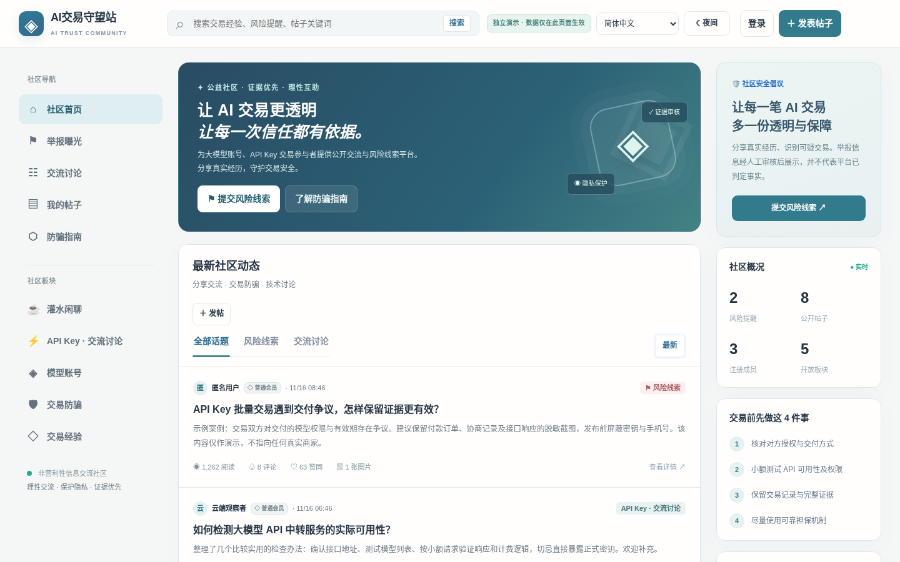
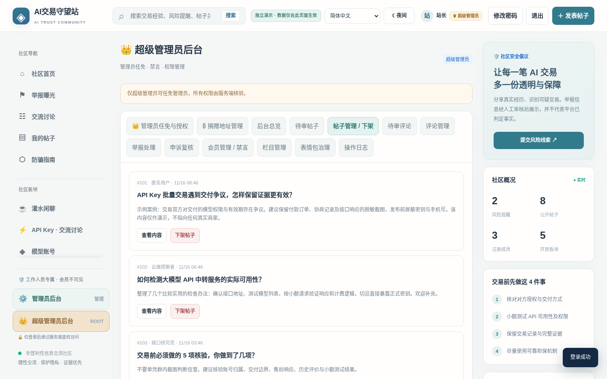
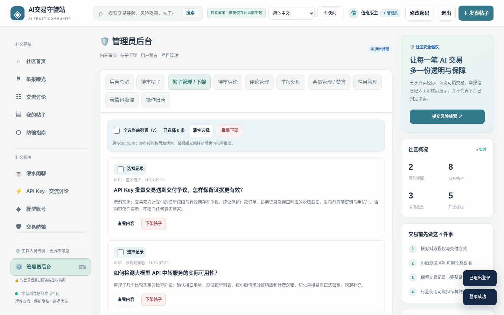

# AI交易守望站 / AI Trust Community

> 一个以证据保护、申诉纠错和权限审计为核心的 AI 大模型账号 / API Key 交易安全公益交流论坛。

**功能增强版：`v1.1.0`（内部开发代号 V3.2）** | Node.js 22 · Express 4 · MySQL 8.4 · Redis 7 · Docker Compose

> **项目状态：开源 MVP / 参考实现。** 已通过53项 Node 测试、本地 MySQL 8.4.13 的14组API验证、旧表升级及 Chromium 实际网页交互；目标 Linux Docker、真实 Redis、SMTP、Turnstile、翻译模型和并发容量仍须部署时验收。正式开放注册前，请完成 [上线验收清单](docs/上线与开源验收清单.md)。

**页面预览（模拟数据）**







## 下载与版本

当前版本为 **V3.2 / v1.1.0**，代码以 MIT 许可公开。

- [下载新版五文件目录](%E5%8F%91%E8%A1%8C%E6%96%87%E4%BB%B6/AI%E5%AE%88%E6%9C%9B%E8%80%85%E4%BB%A3%E7%A0%81-V3.2%E5%8A%9F%E8%83%BD%E5%A2%9E%E5%BC%BA%E7%89%88/)，保留原文件名和数量；文件名中 V3.1 不代表内部版本。
- [旧版 V3.1 / v1.0.1 五文件目录](%E5%8F%91%E8%A1%8C%E6%96%87%E4%BB%B6/AI%E5%AE%88%E6%9C%9B%E8%80%85%E4%BB%A3%E7%A0%81-%E4%BF%AE%E5%A4%8D%E6%9C%80%E7%BB%88%E7%89%88/)仍然保留。
- [旧版完整源码](https://github.com/liamloveme/ai-trust-community/tree/version/v1.0.1)保存在独立版本分支，提交历史不改写。
- [v1.1.0 更新说明](docs/releases/v1.1.0.md)包含新增功能、验证结果和数据库升级步骤。

| 新版文件 | 用途 |
| --- | --- |
| [GitHub 开源首发指南.md](%E5%8F%91%E8%A1%8C%E6%96%87%E4%BB%B6/AI%E5%AE%88%E6%9C%9B%E8%80%85%E4%BB%A3%E7%A0%81-V3.2%E5%8A%9F%E8%83%BD%E5%A2%9E%E5%BC%BA%E7%89%88/GitHub%20%E5%BC%80%E6%BA%90%E9%A6%96%E5%8F%91%E6%8C%87%E5%8D%97.md) | 开源发布指南 |
| [V3.1 .html](%E5%8F%91%E8%A1%8C%E6%96%87%E4%BB%B6/AI%E5%AE%88%E6%9C%9B%E8%80%85%E4%BB%A3%E7%A0%81-V3.2%E5%8A%9F%E8%83%BD%E5%A2%9E%E5%BC%BA%E7%89%88/V3.1%20.html) | 离线交互预览，使用模拟数据 |
| [V3.1 完整前后端源码.zip](%E5%8F%91%E8%A1%8C%E6%96%87%E4%BB%B6/AI%E5%AE%88%E6%9C%9B%E8%80%85%E4%BB%A3%E7%A0%81-V3.2%E5%8A%9F%E8%83%BD%E5%A2%9E%E5%BC%BA%E7%89%88/V3.1%20%E5%AE%8C%E6%95%B4%E5%89%8D%E5%90%8E%E7%AB%AF%E6%BA%90%E7%A0%81.zip) | 完整源码、依赖锁文件和部署配置 |
| [全量产品需求计划书.docx](%E5%8F%91%E8%A1%8C%E6%96%87%E4%BB%B6/AI%E5%AE%88%E6%9C%9B%E8%80%85%E4%BB%A3%E7%A0%81-V3.2%E5%8A%9F%E8%83%BD%E5%A2%9E%E5%BC%BA%E7%89%88/%E5%85%A8%E9%87%8F%E4%BA%A7%E5%93%81%E9%9C%80%E6%B1%82%E8%AE%A1%E5%88%92%E4%B9%A6.docx) | 完整需求和新增功能说明 |
| [Codex 部署提示词.md](%E5%8F%91%E8%A1%8C%E6%96%87%E4%BB%B6/AI%E5%AE%88%E6%9C%9B%E8%80%85%E4%BB%A3%E7%A0%81-V3.2%E5%8A%9F%E8%83%BD%E5%A2%9E%E5%BC%BA%E7%89%88/Codex%20%E9%83%A8%E7%BD%B2%E6%8F%90%E7%A4%BA%E8%AF%8D.md) | 部署、迁移与验收步骤 |

GitHub 提供源码和文件下载；体验界面可下载 HTML 用浏览器打开，部署论坛请使用源码。项目分享地址：[AI Trust Community](https://github.com/liamloveme/ai-trust-community)。

## V3.2 置顶与页脚联系方式

版本为 v1.1.0，研发名称 V3.2 功能增强版。本版基于已修复的 v1.0.1 增量修改，保留其余功能。外层五个文件沿用原文件名（包括 V3.1），以内部版本号识别本次更新。

| 功能 | 超级管理员 | 管理员 | 普通会员 |
| --- | --- | --- | --- |
| 社区首页置顶 | 可设置 | 禁止 | 禁止 |
| 首页之外的帖子列表置顶 | 可设置 | 可设置 | 禁止 |
| 页脚联系方式配置 | 可设置 | 禁止 | 禁止 |

进入管理员后台的「帖子置顶」标签；超管看到首页、板块两个独立开关，管理员仅看到板块开关。只允许处理已公开帖子，可搜索和翻页。板块置顶适用于举报曝光、交流讨论及各讨论栏目中本来符合筛选条件的帖子，不把帖子跨栏目复制。独立内容页没有帖子列表。搜索结果和「我的帖子」继续使用原顺序。置顶帖子优先显示，同组仍按新帖或热度排序；允许多条置顶。下架或驳回会清除两种置顶，重新发布时不自动恢复。新增板块置顶是管理员角色能力，可用于任意已公开作者的帖子；原有审核、删除及禁言的作者层级规则不变。

超管进入「超级管理员后台 → 页脚联系方式」，启用总开关，最多添加4行不同类型，左侧选 QQ、Telegram、X、TikTok、微信、Discord、WhatsApp、邮箱或其他，右侧填账号/号码。每行也可独立关闭；空行请关闭或移除。保存后在页脚底部中间竖向显示，手机端自动换行。关闭总开关后公开页为空，公开接口不返回后台保留的号码。配置带签名、版本冲突检查和审计，审计不保存号码。前端按纯文本显示，不执行填写内容中的 HTML。

默认两个置顶字段均为关闭，联系方式默认关闭且为空。不新增生产密钥，联系方式复用原 DONATION_CONFIG_HMAC_KEY，升级时必须保留原密钥。不要把本机体验账号或 .env 带到生产环境。

## 从 v1.0.1 升级到 v1.1.0

新安装使用空数据卷与最新 database/schema.sql，已包含置顶字段；不要再运行007。已有 V3.1 修复版先备份数据库、上传与表情卷并确认可恢复，停止 app 写入，**只执行一次 database/migrations/007-v3.2-pins.sql**，再更新镜像并启动 app。该脚本新增两个默认0的字段及索引，不删除原数据；已有数据卷不会自动迁移。更早版本先补齐此前缺失迁移。不要对生产旧库运行全量 schema.sql，也不要执行 docker compose down -v。

Linux / Docker Compose 下，在正确项目目录和已载入正式环境配置的前提下执行（已有 v1.0.1 数据库）：

```bash
docker compose stop app
docker compose exec -T db sh -c 'MYSQL_PWD="$MYSQL_PASSWORD" exec mysql -u"$MYSQL_USER" "$MYSQL_DATABASE"' < database/migrations/007-v3.2-pins.sql
docker compose up -d --build app
docker compose ps
curl -fsS http://127.0.0.1:3000/api/health
```

确认迁移成功后再启动新版应用；遇到 Duplicate column 表示字段可能已存在，先核对数据库版本与字段，不盲目重跑。回滚应用可保留新增字段和原数据，数据库回滚按已验证备份方案实施，不直接删卷。验收超管/管理员/会员权限、置顶顺序、下架清除、联系方式关闭和并发保存。

## 核心功能

- 公共社区：灌水闲聊、API Key 交流、模型账号、交易防骗、交易经验；管理员可创建分类或独立内容页面。
- **统一登录**：邮箱注册、登录、密码修改；邮箱找回密码需要 SMTP；普通会员不能选择管理员身份。
- 证据保护：帖子公开图片 20 张、私密证据 20 张、评论图片 20 张；单张 5 MB；仅静态 JPG/PNG/WebP，拒绝视频等。
- Emoji 与私人表情库：原生 Emoji 分类/搜索；个人私有表情最多 200 张、单个 1 MB；受权限约束的后台治理。
- 分级后台：普通管理员按授权处理会员内容；超级管理员包含全部审核能力，并可任免管理员、查看全站管理审计和修改捐赠地址。
- **勾选式批量审核：** 待审帖子（包括举报曝光）、评论、举报、申诉、下架、会员禁言、栏目启停与表情治理支持部分勾选或全选当前列表；统一填写审核依据，风险内容批量发布须确认已核对证据；每条有独立权限检查及审计编号。
- 帖子详情来源回退：**从待审、下架管理、论坛搜索或分类进入详情，返回原列表；处理下架后回到原后台并刷新列表。**
- 审计：记录操作人、UID、时间、动作、对象、处理依据。管理员只能查询自己的管理日志，超管可查询全部。
- 主题与国际化：日/夜模式、24 种界面语言选择、响应式界面；帖子原文不自动改写。
- 可选自建翻译：LibreTranslate 翻译公开帖子的标题与正文，模型语言支持取决于实际安装环境。
- 公益捐赠：BTC、USDT、USDC 的指定网络地址；仅超管可编辑，二次密码验证、HMAC 校验与审计。

**明确边界：** 本站不是支付担保或司法诈骗认定机构；举报和纠纷内容应经过审核与必要脱敏，不应公开密钥、手机号、证件和银行卡信息。

## 一分钟体验（无需部署）

下载项目包里的 `AI交易守望站-独立HTML预览.html`，浏览器直接打开。该文件是**模拟交互数据**，并不连接 MySQL。仅用于检查界面，演示账号不会在真实部署中创建。真实服务必须走 `public/index.html` 和后端 API。

## 项目目录

```text
├── public/                 # 正式网页前端和多语言资源
├── src/                    # Express API、认证、RBAC、审计、文件安全、翻译
├── database/
│   ├── schema.sql          # 全新安装的完整 MySQL Schema
│   └── migrations/         # 已有旧版数据库的增量升级（不可重复全量运行）
├── scripts/                # 初始化超级管理员、维护、预览构建
├── tests/                  # Node.js 单元测试、Chromium 浏览器回归脚本
├── docs/
│   ├── 完整产品需求计划书-PRD.md   # 从零到部署的完整 PRD
│   ├── 上线与开源验收清单.md
│   ├── Codex一键部署提示词.md
│   └── GitHub首发说明.md
├── .github/                # CI、issue/PR 模板、依赖更新配置
├── docker-compose.yml
├── Dockerfile
├── .env.example
└── LICENSE / SECURITY.md / CONTRIBUTING.md
```

## 使用 Docker Compose 从零部署

**环境要求：** Ubuntu Linux / Docker Engine + Compose Plugin，小规模测试按实际需求配置；数百人多语言首发建议网站 8 核/16 GB RAM/100–200 GB SSD，独立翻译机按语言数量从 8 核/16 GB 到 16 核/32 GB 起步，容量须实测。已绑定域名及 HTTPS 反向代理；入站建议 Cloudflare/WAF。`db` 与 `redis` 不应映射到公网。

1. 获取项目代码，复制环境示例：

   ```bash
   git clone https://github.com/liamloveme/ai-trust-community.git
   cd ai-trust-community
   cp .env.example .env
   ```

2. **编辑 `.env`**，至少配置 `DB_PASSWORD`、`MYSQL_ROOT_PASSWORD`、`REDIS_PASSWORD`（三组各自不同的高强度随机密码）、`DONATION_CONFIG_HMAC_KEY`（使用 `openssl rand -hex 32` 生成并持久保存）、`PUBLIC_ORIGIN=https://你的域名`、`NODE_ENV=production`、`COOKIE_SECURE=true`。生产环境必须配置 Turnstile 正式 sitekey/secret；邮件找回密码还需 SMTP。示例现在默认 production，必须替换域名和所有密钥。TRUST_PROXY=1 仅适用于一层受控反代，不能把该值直接用于任意代理链。

3. **确认初次安装使用空的 MySQL 数据卷**，然后运行：

   ```bash
   docker compose config --quiet
   docker compose up -d --build
   docker compose ps
   curl -fsS http://127.0.0.1:3000/api/health
   ```

   MySQL **首次创建数据卷时**将运行 `database/schema.sql`。旧版数据卷不会自动运行建表脚本，请按旧版迁移文档执行迁移并首先验证备份可恢复。**不要对已有生产库执行 `docker compose down -v`。**

4. 通过专用初始化命令生成**唯一初始超级管理员**（不要在仓库或公共终端日志放真实密码）：

   ```bash
   docker compose run --rm \
     -e INIT_ADMIN_USERNAME='你的管理员昵称' \
     -e INIT_ADMIN_EMAIL='你的管理员邮箱' \
     -e INIT_ADMIN_PASSWORD='临时强密码_至少12位' \
     app node scripts/bootstrap-admin.js
   ```

   上面命令仅为格式示例；**实际使用请避免将密码记录进 shell history**，可改用受权限控制的临时环境变量注入方式。初始化完成后立即清除部署系统里的初始化密码、登录站点修改密码。程序检测到已有超管会拒绝覆盖。

5. 通过受信反向代理 / Cloudflare Tunnel 将 HTTPS 流量转发到仅监听 `127.0.0.1:3000` 的服务；确认公网无法连接 3000、3306、6379。

6. 可选翻译服务（需额外 CPU/内存及模型下载；不是所有 UI 语言均有翻译模型）：

   ```bash
   docker compose --profile translate up -d
   ```

7. 测试 SMTP 找回密码、审核、私密证据隔离、捐赠地址修改、防越权、备份恢复等，**全部验收后**再开放注册。

## 审核工作台批量操作

进入管理员或超级管理员后台的有权限列表，勾选单条记录或点“全选当前列表”，再点对应批量动作（批准、驳回、下架等）。提交前填写至少 5 字处理依据；对风险曝光与包含图片/证据的内容，批量通过须勾选人工核验确认。可先点“核对内容”查阅完整证据，再返回原队列。

**服务端逐条校验权限**，普通管理员只能处理普通会员；最多 100 条/批次，逐条提交事务并生成带 `batch_id` 的审计，部分失败会展示失败 ID 与原因。管理员任免、捐赠配置和审计只读页面不提供批量修改，避免高敏感误操作。

## 旧版数据库升级

- **全新部署：** 只使用 `database/schema.sql`，无需执行旧版增量迁移。
- **已有 V2.7/V3.0 或 V3.1：** 先核对旧版本迁移是否齐全；升级本版 V3.2 必须备份后执行一次 `database/migrations/007-v3.2-pins.sql`，再更新应用。V3.1 的批量审核使用现有审计字段，本版新增了两个置顶字段。
- **更早版本：** 先确认当前 schema 版本，按 `database/migrations/` 的历史顺序逐项升级；脚本可能不适用于任意跳版本，请在副本环境演练，并验证实际历史数据。

## 开发与测试

```bash
# 已安装 Node.js 22 且可访问 npm 源时：
npm ci
npm test
node --check src/server.js
node --check public/app.js

# Python 环境有 Playwright + Chromium 时：
python scripts/build-preview.py
python tests/v3-navigation-browser.py
python tests/v31-batch-browser.py
python tests/v27-browser.py
```

**构建与验证：** 已生成 package-lock.json 并完成依赖审计。请使用 npm ci；生产目标仍须完成 Linux 构建及真实服务验收。

## 安全与合规

- 用户权限在后端执行，客户端是否显示按钮不构成授权依据；超级管理员/管理员与普通会员的处罚范围不同。
- 上传文件使用安全重编码和白名单验证；文件访问受服务器权限约束。
- CSRF、限流、Turnstile、响应头和源站内网隔离是基础控制；**无法保证绝对防 DDoS**。
- 举报由人工复核；须提供申诉纠错机制，不得用于隐私曝光、诽谤或付费删帖。
- 公开仓库请勿包含 `.env`、真实捐赠地址配置、私钥、邮件凭据、生产数据或用户上传图片。
- 请参阅 [安全漏洞报告](SECURITY.md)、[贡献规范](CONTRIBUTING.md) 和 [发布前验收](docs/上线与开源验收清单.md)。

## 开源许可

代码默认以 **MIT License** 发布（见 `LICENSE`）；上传的用户内容、第三方 Logo、API Key、商标与第三方依赖不因此获得授权。首次公开前由项目所有者核对权利归属并决定最终许可证。第三方依赖及独立翻译引擎遵循其各自许可证。

## 历史修复 V3.1 v1.0.1

2026-11-16 修复：sharp 升至 0.35.5 并提交 npm 锁文件；验证码在失败重试前刷新；单条举报和申诉执行目标身份检查；单条内容、表情和栏目管理将数据与审计放入同一事务；批量参数错误返回 400；API 日期输出 UTC；评论审核增加受限上下文入口；健康检查探测 MySQL/Redis，另设存活检查；翻译缓存按内容生成，合并同篇并发请求，使用有界队列和 Redis 共享缓存；巴西葡萄牙语使用 pb；补齐表情卷目录与 Compose 健康检查。

本次在 Windows x64 的 Node 22.23.5 上执行 48 项 Node 测试通过，包括实际 Express HTTP 路由配合数据库事务替身，以及 JPG/PNG/WebP 上传重编码。npm 官方依赖审计为 0 条已知漏洞。测试结果不代表未知漏洞不存在。真实 Linux Docker、MySQL、Redis、SMTP、Turnstile 和 LibreTranslate 模型仍须在目标服务器验收。

运行依赖使用 package-lock.json 和 npm ci。不要在目标服务器重新生成锁文件来掩盖构建失败。以上为旧版历史记录；当前V3.2升级必须运行007，详见前文。本次验证结果见 [测试与交付说明](docs/测试与交付说明.md)。

## 反向代理和运行检查

Compose 只把 app 端口绑定到服务器 127.0.0.1。单层 Nginx 应使用 proxy_set_header X-Forwarded-For $remote_addr，覆盖不可信访客传入的转发头；同时设置 Host、X-Forwarded-Proto。若前面另有 Cloudflare，先按 Cloudflare 官方 IP 范围设置 Nginx 的真实 IP 信任规则，确认 $remote_addr 是访客地址，再转发到 app。不要开启信任所有代理。用两个不同出口的客户端验证 req.ip/限流确实独立。

Nginx 的 client_max_body_size 可设 6m，proxy_read_timeout 建议 120s，以覆盖翻译排队与长帖推理。全站普通 API 与媒体现在分别限流，健康检查不消耗访客额度。限流仍按真实 IP 生效，企业 NAT 场景需要结合监控评估。

- /api/live：进程存活；/api/health：MySQL/Redis 就绪，故障返回 503。
- /api/translation/languages：实际翻译模型能力；翻译未启动返回 available=false，不使整个论坛失效。
- 启动后在 app 容器内分别对 /app/data/uploads 和 /app/data/stickers 执行 test -w，确认可写。新镜像预建两个目录；旧数据卷权限错误应先备份，再修复所有者，不能通过删除数据卷解决。

## 自建翻译运行参数

启用 docker compose --profile translate up -d --build。镜像固定为 libretranslate/libretranslate:v1.9.6，首次下载模型可能较慢；健康检查会等待启动阶段。默认加载 en,zh,zt,ja,ko,es,fr,de,pb，可通过 TRANSLATE_LOAD_ONLY 明确增减。界面语言与已装模型是两个不同概念。

每个 Node 进程默认最多 2 个翻译任务，排队最多 32 个，排队超时 15 秒，上游每次请求超时 30 秒；标题和正文依次处理，队列满返回 429。相同内容的同进程请求合并，Redis 缓存最多 500 条/30 分钟。多实例部署时，总翻译并发是各进程限额之和，应按翻译机负载分配。更换模型后递增 TRANSLATE_MODEL_REVISION，避免继续使用旧模型缓存。

分离部署时，将 TRANSLATE_INTERNAL_URL 改为翻译机私网地址，例如 http://10.0.0.20:5000；受控内部 DNS 名需加入 TRANSLATE_ALLOWED_HOSTS。翻译服务只允许论坛服务器访问，不公开映射到任意公网地址。可在独立翻译机用 docker run 启动同一固定镜像，端口仅绑定其私网 IP，模型目录挂持久卷，设置同样的 LT_LOAD_ONLY、LT_THREADS=2、LT_CHAR_LIMIT=8500；安全组只允许网站机私网 IP 访问 5000。

默认 Compose app 限额为 2 CPU/2 GB，翻译为 8 CPU/16 GB，可分别通过 APP_CPUS、APP_MEMORY、TRANSLATE_CPUS、TRANSLATE_MEMORY 调整。默认翻译 profile 面向有相应资源的主机；只有 8 核/16 GB 的同机内测应减少模型和容器限额，不能照抄全量 profile。在线人数不等于同时翻译人数，上线前需分阶段压测。
